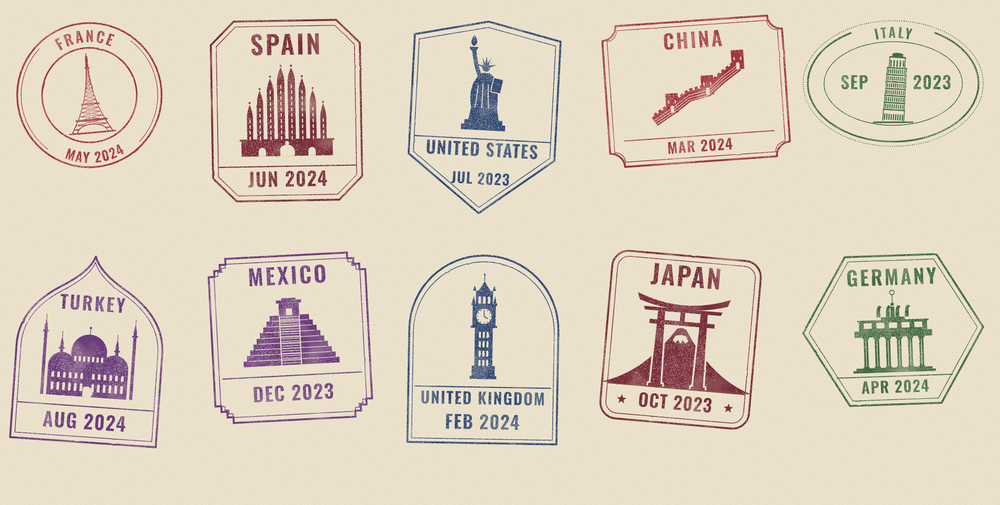

# Passport stamps

*Example output from `trips.top10.csv`. Every country has its own frame and monument, one ink colour, and the month and year filled in by the script.*

One folder per country: countries/<code>/ holds country.json, frame.mjs, monument.svg.

    node stamp.mjs make FR 2024-05            one stamp -> out/
    node stamp.mjs batch trips.example.csv    many stamps from a CSV or JSON file
    node stamp.mjs new DE GERMANY navy oval   scaffold a country (circle | box | oval)
    node stamp.mjs validate                   check every country before you ship
    node stamp.mjs serve 3000                 GET /stamp/FR/2024/05.png

From code: `import { stampPNG } from './render.mjs'; await stampPNG('FR', 'MAY', 2024)`.

Adding a country: run `new`, replace monument.svg (flat shapes, colour INK only, origin at the middle),
reshape frame.mjs if it should look different, run `validate`.
Same country + month + year always gives the same look; pass --seed, --rotate or --wear to override.

## Included countries

FR, ES, US, CN, IT, TR, MX, GB, JP, DE. Each has its own frame shape and monument.
`trips.top10.csv` makes one stamp for each: `node stamp.mjs batch trips.top10.csv --out out/top10`.
Monuments are generated by tools/make-monuments.mjs (first versions; redraw by hand for a final set).
